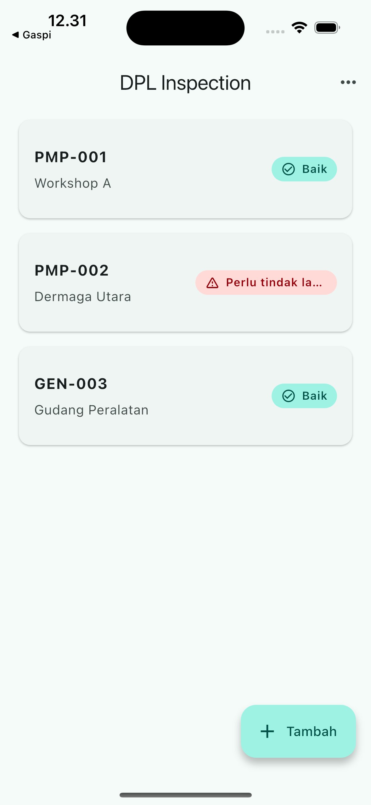
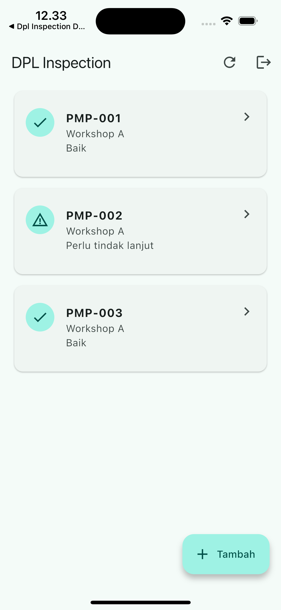

# Paket Training Flutter 3 Hari — Proyek Lengkap + iPhone 16

**Trainer dan Pembuat Buku: Damar Galih Aji Pradana, S.Tr.Kom.**

Paket untuk tim developer PT. Dok Pantai Lamongan yang sudah mengenal Kotlin.
Praktik kelas dijalankan pada iPhone 16 Simulator yang lebih ringan daripada
varian Pro/Pro Max. Source Android tetap dibuat untuk kebutuhan build lanjutan.

## Toolchain yang dikunci

- Flutter 3.44.8 stable
- Dart 3.12.2
- DevTools 2.57.0
- Xcode 26.5
- Simulator: iPhone 16, iOS 18.0

Setiap proyek mempunyai `.fvmrc` dan `pubspec.lock`. Gunakan FVM agar laptop
peserta dan CI memakai versi yang sama:

```sh
fvm install 3.44.8
fvm flutter --version
```

## Tiga proyek hasil `flutter create`

| Hari | Folder | Hasil utama |
|---|---|---|
| 1 | `../flutter_projects/hari_1_dpl_inspection` | UI, form, navigation, state lokal |
| 2 | `../flutter_projects/hari_2_dpl_inspection_api` | Login, REST API, token, cache, POST |
| 3 | `../flutter_projects/hari_3_dpl_inspection_release` | Foto, izin iOS, test, build |

Semua folder adalah proyek mandiri hasil
`flutter create --platforms=android,ios`. Masing-masing memiliki README, test,
konfigurasi platform, lockfile, dan instruksi GitHub. Karena mandiri, setiap
folder dapat menjadi repository GitHub terpisah.

## Hari 1 — UI dan form

```sh
cd ../flutter_projects/hari_1_dpl_inspection
fvm flutter pub get
fvm flutter analyze
fvm flutter test
fvm flutter run -d "iPhone 16"
```

Proyek mencakup model, validator, daftar/detail/form, loading, empty state,
error/retry, theme, komponen reusable, dan widget test.



## Hari 2 — API, state dan storage

Jalur utama kelas memakai API Express yang dipublikasikan melalui Docker dan
didokumentasikan lewat Swagger/OpenAPI. Ganti placeholder di bawah dengan URL
HTTPS dari PIC backend:

```sh
cd flutter_projects/hari_2_dpl_inspection_api
fvm flutter pub get
fvm flutter run -d "iPhone 16" \
  --dart-define=API_BASE_URL=https://HOST_API_TRAINING
```

Sebelum wiring UI, verifikasi `/health`, `/docs` atau `/openapi.json`, login,
GET, POST, 401, dan 422. Checklist handoff berada di
`API_HANDOFF_EXPRESS_SWAGGER_DOCKER.md`.

Jika hosting atau jaringan kelas bermasalah, gunakan mock lokal yang mempunyai
kontrak sama:

Jalankan mock API dari root paket:

```sh
python3 materi_pendamping/praktik/mock_api/mock_api.py --host 127.0.0.1 --port 8000
```

Terminal kedua:

```sh
cd flutter_projects/hari_2_dpl_inspection_api
fvm flutter pub get
fvm flutter run -d "iPhone 16" \
  --dart-define=API_BASE_URL=http://localhost:8000
```

Login dummy: `trainer` / `training123`. Proyek sudah lengkap dengan UI login,
list/detail/form, ApiClient, repository, ChangeNotifier, secure token, cache,
session expiry, retry, logout, dan POST. Token statis hanya untuk kelas.



Fault simulation tetap tersedia:

```sh
python3 materi_pendamping/praktik/mock_api/mock_api.py --fail-list
python3 materi_pendamping/praktik/mock_api/mock_api.py --fail-create
python3 materi_pendamping/praktik/mock_api/mock_api.py --delay 11
python3 materi_pendamping/praktik/mock_api/mock_api.py --empty
```

## Hari 3 — foto, testing dan build

```sh
cd flutter_projects/hari_3_dpl_inspection_release
fvm flutter pub get
fvm flutter analyze
fvm flutter test
fvm flutter run -d "iPhone 16"
```

`PhotoPanel` menangani pilihan Galeri/Kamera, cancel, error, dan lost-data
recovery. Kamera simulator dapat tidak tersedia; gunakan Galeri untuk latihan
dan perangkat fisik untuk acceptance kamera.


## Push GitHub per hari

Jalankan dari folder proyek yang ingin dipush:

```sh
git init
git add .
git commit -m "Complete Flutter training checkpoint"
git branch -M main
git remote add origin https://github.com/USERNAME/NAMA-REPO.git
git push -u origin main
```

Jangan commit token, `.env`, password, keystore, atau data operasional.

## Status verifikasi

Ketiga proyek sudah dijalankan dengan Flutter 3.44.8 pada iPhone 16 Simulator.
Semuanya lulus `flutter analyze` dan `flutter test`. Screenshot di atas diambil
langsung dari simulator 1179×2556; Hari 2 diverifikasi bersama mock API aktif.
Contoh tetap merupakan aplikasi training, bukan aplikasi production.
