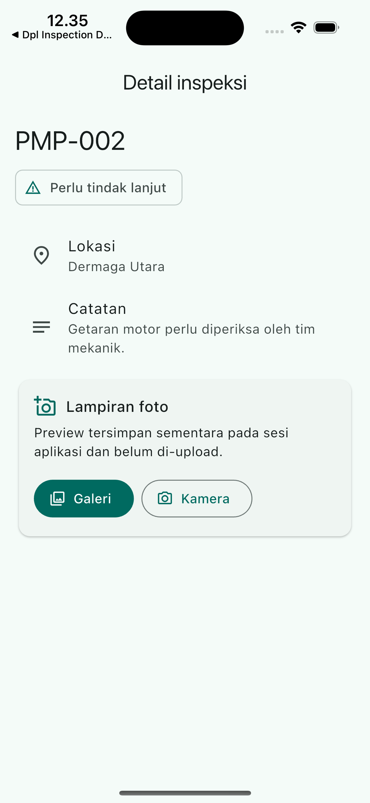

# Materi Hari 3 Flutter Siap Uji
**Native feature, testing, DevTools dan build | iPhone 16 Simulator**

**Trainer dan Pembuat Buku: Damar Galih Aji Pradana, S.Tr.Kom.**

> **Proyek resmi:** `flutter_projects/hari_3_dpl_inspection_release`, hasil
> lengkap `flutter create` dengan Flutter 3.44.8. Praktik plugin dijalankan pada
> iPhone 16 Simulator; Galeri dapat diuji di simulator, sedangkan kamera wajib
> divalidasi pada perangkat fisik. Source Android tetap tersedia untuk APK/AAB.

{ width=42% }

## Target hari ini
Selesaikan satu aplikasi Flutter yang dapat didemonstrasikan dari daftar inspeksi sampai foto lokal pada iPhone 16 Simulator, kemudian buktikan kualitasnya melalui test, DevTools, dan build. Kamera diterima pada perangkat fisik; source Android tetap dapat dipakai untuk tahap APK/AAB setelah praktik simulator selesai.

## Jadwal
| Waktu | Praktik | Hasil |
|---|---|---|
| 08.30-10.00 | Plugin foto, cancel/error/lifecycle | Preview foto pada detail yang benar |
| 10.15-12.00 | Unit/widget test dan profiling | Test lulus; bukti satu perbaikan |
| 13.00-14.10 | Polishing Flutter end-to-end | Responsive UI, retry/cache dan session stabil |
| 14.10-14.30 | Konfigurasi iOS | Permission string, simulator, dan batas kamera |
| 14.45-16.00 | Android signing, build dan smoke test | APK/AAB; signer dan hasil uji |
| 16.00-16.30 | Review PRD dan handover | Tag day-3; catatan release/blocker |

## Memilih plugin tanpa kehilangan fokus
Plugin menghubungkan Dart ke layanan platform. Gunakan plugin yang terawat untuk kebutuhan umum; MethodChannel digunakan ketika perilaku native yang dibutuhkan tidak tersedia melalui plugin. Satu native feature foto sudah cukup untuk mempelajari konfigurasi, error, lifecycle dan batas antara Dart dengan Android.

```text
flutter pub add image_picker
flutter pub get
flutter run -d "iPhone 16"
```

Full restart setelah pemasangan. Baca README versi paket terpasang dan periksa minimum SDK jika resolver/build menunjukkan ketidakcocokan. Hindari menambahkan location/file/notification bersamaan dalam kelas 3 hari: setiap fitur mempunyai konfigurasi dan skenario uji sendiri.

**Checkpoint awal:** semua acceptance hari 2 tetap lulus sebelum fitur foto dipasang. Trainer memeriksa bahwa Swagger/OpenAPI sesuai dengan payload hosted Express API, UI/detail dan data model tetap bekerja, serta image/version Docker dan base URL training sudah dicatat. Mock Python hanya menjadi fallback kontrak yang sama.

<!-- PAGE -->
## Foto lintas platform dan lifecycle async
image_picker menghasilkan XFile atau null jika pengguna membatalkan. Foto kamera dapat berada di cache sementara. Pada iPhone Simulator gunakan Galeri; validasi kamera dilakukan pada perangkat fisik. Latihan hanya menampilkan preview; tidak mengubah API atau menjanjikan persistence.

```dart
final picker = ImagePicker();
bool isPicking = false;
XFile? attachment;

Future<void> pickPhoto(ImageSource source) async {
  if (isPicking) return;
  setState(() => isPicking = true);
  try {
    final picked = await picker.pickImage(
      source: source, maxWidth: 1600, imageQuality: 80);
    if (!mounted || picked == null) return;
    setState(() => attachment = picked);
  } on PlatformException {
    if (mounted) showPhotoError();
  } finally {
    if (mounted) setState(() => isPicking = false);
  }
}
```

Imports: image_picker/image_picker.dart, flutter/services.dart, dan dart:io untuk Image.file pada target Android. Potongan berada pada State detail. Widget PhotoPanel yang lebih lengkap ada pada folder praktik/hari_3.

### Langkah praktik foto
1. Tambahkan tombol galeri dan kamera pada detail. Nonaktifkan selama picker berjalan.
2. Bila hasil null, pertahankan preview sebelumnya. Bila berhasil, tampilkan Image.file dan tombol hapus.
3. Ikat panel dengan ValueKey inspection.id agar state foto tidak berpindah saat detail record berubah.
4. Simulasikan batal dan error/permission denied. Bila plugin/Android meminta permission, ikuti flow platform dan tampilkan pesan yang dapat dipahami.
5. Saat Android mematikan activity ketika picker aktif, retrieveLostData membantu memulihkan hasil. Simpan id inspeksi sebelum membuka picker; recovery harus dipetakan ke record itu.
6. Uji physical device untuk kamera. Jangan menyatakan foto permanen hanya karena preview tampil.

**MethodChannel demo 10 menit:** trainer menjelaskan nama channel yang sama di Dart dan Kotlin, invokeMethod, response asinkron, dan PlatformException. Tidak perlu menulis fitur native kedua; bahas kapan plugin sudah cukup dan kapan custom native diperlukan.

<!-- PAGE -->
## Testing yang membuktikan perilaku
Unit test memeriksa aturan/parser tanpa UI. Widget test memeriksa interaksi dan tampilan. Smoke test pada device memeriksa integrasi nyata termasuk plugin, jaringan dan release config. Masing-masing mempunyai tujuan; widget test yang lulus tidak membuktikan permission kamera di device bekerja.

### Unit test validator
```dart
import 'package:flutter_test/flutter_test.dart';
import 'package:dpl_inspection/validation.dart';

void main() {
  test('needs_action rejects short trimmed note', () {
    expect(validateNote('needs_action', '  cek  '), isNotNull);
  });
  test('good allows empty note', () {
    expect(validateNote('good', ''), isNull);
  });
  test('needs_action accepts a useful note', () {
    expect(validateNote('needs_action', 'Getaran motor tinggi'), isNull);
  });
}
```

Tambahkan test Inspection.fromJson untuk payload valid dan field wajib hilang. Gunakan package name sesuai pubspec.yaml. Test file bawaan counter template diganti dengan test aplikasi latihan; jangan mempertahankan expected behavior template yang sudah dihapus.

### Widget test form
Render MaterialApp dengan InspectionForm. Tekan simpan tanpa mengisi, lalu pastikan pesan kode/lokasi wajib muncul dan Navigator tidak menutup form. Isi data needs_action dengan catatan pendek; pastikan tetap ditolak. Folder praktik berisi test untuk starter hari 1 yang dapat diperluas ke controller/API hari 2.

```text
dart format lib test
flutter analyze
flutter test
```

### Latihan testing 45 menit
1. Jalankan test baseline, buat satu perubahan yang sengaja merusak validator, lihat test gagal.
2. Pulihkan kode dan buktikan test kembali lulus.
3. Tambahkan test untuk success/error/retry controller menggunakan fake repository.
4. Tulis nama test yang menjelaskan perilaku. Jangan hanya mengetes bahwa constructor menghasilkan nilai yang baru saja diberikan.

**Expected result:** peserta dapat menjelaskan masalah yang akan tertangkap test dan masalah yang masih perlu device test.

<!-- PAGE -->
## Debugging dan performance Flutter
Gunakan Widget Inspector untuk struktur/constraint, debugger untuk aliran aksi/data, dan DevTools untuk pengamatan render/rebuild/memory. Network log hanya berisi endpoint, status dan timing; jangan merekam token/password atau body sensitif.

```text
flutter run --profile
```

Gunakan physical device yang sama untuk membandingkan pengukuran. Debug mode mempunyai overhead; jangan menyimpulkan kualitas release hanya dari frame saat debugger aktif. Pilih skenario yang dapat diulang, misalnya scroll daftar panjang atau mengetik search ketika daftar tampil.

### Pengukuran dan perbaikan 45 menit
1. Tambahkan data dummy secukupnya untuk membuat list dapat di-scroll; pisahkan dari server operasional.
2. Rekam skenario singkat di DevTools Performance; amati frame lambat dan pekerjaan berulang.
3. Periksa apakah pencarian/parsing besar dikerjakan setiap build dan apakah seluruh tree dibangun ulang oleh perubahan kecil.
4. Pilih satu perbaikan: ListView.builder, pindahkan komputasi, pecah widget, scope listener, atau thumbnail image yang sesuai.
5. Ulangi skenario pada device/mode yang sama; catat dampak dan batas pengamatan.

### Checklist teknik yang digunakan
- const pada widget dengan konfigurasi tetap membantu mengurangi pekerjaan yang tidak perlu; bukan obat untuk semua frame lambat.
- Jangan decode/parsing data besar atau menjalankan request berulang dari build.
- Bangun list secara lazy dan gunakan key berbasis ID stabil.
- Batasi ukuran gambar yang diproses untuk preview; periksa memory ketika memilih foto besar.
- Dispose controller/listener/client sesuai pemiliknya. Jangan memakai context/controller lama setelah navigation.
- Bedakan latensi API dari masalah render UI; indikator loading tidak mempercepat server.

**Bukti:** nama device/mode, skenario, gejala, perubahan, screenshot/timing sebelum-sesudah dan kesimpulan pendek. Bila gejala tidak terukur, jangan membuat klaim peningkatan persen; jelaskan perbaikan kode dan apa yang masih perlu diukur.

## Troubleshooting Flutter
Jika list tidak berubah, periksa assignment/state notification. Jika gambar menempel pada detail lain, periksa key dan pemilik state. Jika request berulang, periksa lifecycle load. Jika crash muncul setelah kembali layar, periksa mounted/dispose dan event async yang masih selesai.

<!-- PAGE -->
## Menuntaskan alur Flutter dalam 70 menit
Sesi 13.00-14.10 dipakai untuk menyelesaikan acceptance yang belum stabil. Jangan menambah package baru pada sesi ini kecuali memperbaiki blocker yang sudah jelas.

### Skenario end-to-end
1. Buka aplikasi tanpa token; login salah harus tetap di layar login.
2. Login benar; daftar loading lalu data server tampil. Pilih record dan lihat detail.
3. Buat record invalid lalu valid. Submit ganda dicegah; record server muncul tepat sekali.
4. Cari kode/lokasi, filter kondisi dan clear filter. Hasil tidak bercampur dengan error/loading.
5. Setelah GET sukses, hentikan server; refresh menghasilkan cache dengan timestamp dan mode read-only.
6. Hidupkan server, retry berhasil. Logout menghapus token/cache; login ulang tidak memakai data lama.
7. Pada detail, pilih foto, batal, ganti foto dan buka record lain. Preview terkait dengan record yang benar.
8. Putar orientasi, buka keyboard dan uji teks panjang; tidak ada overflow atau tombol tersembunyi.

### Review tampilan
Judul halaman jelas, field mempunyai label, kondisi ditulis sebagai teks, dan tombol mempunyai status disabled/loading yang dapat dipahami. Error memberi aksi berikutnya, empty memberi tombol tambah, dan cache memberi batas yang terlihat. Label teknis internal seperti nama controller atau endpoint tidak ditampilkan ke pengguna.

## Overview Mac dan iOS selama 20 menit
**14.10-14.15:** Flutter memakai sebagian besar kode Dart/UI bersama, tetapi native project, plugin permissions, dan signing tetap berbeda per platform.

**14.15-14.20:** build iOS memerlukan Mac dan Xcode. Simulator berguna untuk UI; fitur device masih perlu pengujian sesuai kemampuan hardware.

**14.20-14.25:** Bundle ID dan Team adalah dasar konfigurasi iOS. Certificate/provisioning serta akses akun perlu dipersiapkan untuk distribusi.

**14.25-14.30:** alur umum adalah konfigurasi, build/archive, upload App Store Connect, lalu TestFlight. Praktik serta review App Store menjadi sesi lanjutan; peserta kembali fokus ke Android setelah overview.

**Peserta tidak perlu membawa Mac.** Tidak ada instalasi, console walkthrough atau acceptance build iOS dalam paket 3 hari ini.

<!-- PAGE -->
## Konfigurasi Android dan signing latihan
Pilih Application ID latihan; sesuaikan namespace serta package/path MainActivity jika identifier diubah. Catat minSdk/targetSdk sesuai SDK/plugin dan kebijakan store yang berlaku saat release; jangan memakai angka lama dari screenshot tanpa verifikasi.

```yaml
version: 0.3.0+3
```

Nama versi dan nomor build berasal dari pubspec.yaml. Nomor build untuk upload berikutnya harus meningkat. Pastikan label app, icon dan izin INTERNET di main manifest sesuai fitur app.

### Keystore khusus kelas
```text
keytool -genkeypair -v -keystore training-upload.jks -keyalg RSA -keysize 2048 -validity 3650 -alias training
```

Perintah satu baris berlaku ketika keytool/JDK berada pada PATH. Biarkan password diminta secara interaktif. Key ini hanya untuk latihan; jangan mengganti signing key aplikasi DPL yang sudah beredar.

Buat android/key.properties sesuai path sebenarnya. Path Windows dalam properties memakai slash / atau backslash yang di-escape. File serta keystore tidak dikomit.

```text
storePassword=ISI_DI_MESIN_LATIHAN
keyPassword=ISI_DI_MESIN_LATIHAN
keyAlias=training
storeFile=PATH_ABSOLUT_KE_TRAINING_UPLOAD_JKS
```

### Langkah konfigurasi Gradle
1. Identifikasi project memakai build.gradle.kts atau build.gradle; jangan mencampur syntax Kotlin DSL dan Groovy.
2. Load key.properties sebelum blok android; buat signingConfigs release dengan alias/password/storeFile tersebut.
3. Pada buildTypes release, pakai signingConfigs release. Hapus assignment debug yang masih tertinggal.
4. Contoh Kotlin DSL ada pada folder praktik/hari_3/signing_kotlin_dsl.txt; ditempel pada lokasi yang dijelaskan, bukan mengganti seluruh file.
5. Abaikan key.properties dan *.jks pada .gitignore; verifikasi file yang staged.

**Poin konsep:** build dengan label release belum membuktikan signer benar. APK/AAB perlu diverifikasi setelah build. Upload key dan Play app signing key mempunyai fungsi berbeda; PIC harus tahu siapa pemegang key aplikasi nyata.

<!-- PAGE -->
## Build Android dan verifikasi artefak
Lakukan analyze/test terlebih dahulu. API release menunjuk staging HTTPS yang disiapkan PIC. Command di bawah memakai placeholder; ganti URL sebelum menjalankan.

```text
flutter build apk --release --dart-define=API_BASE_URL=https://HOST_STAGING_DPL
flutter build appbundle --release --dart-define=API_BASE_URL=https://HOST_STAGING_DPL
```

| Artefak | Lokasi default | Pemeriksaan |
|---|---|---|
| APK | build/app/outputs/flutter-apk/app-release.apk | Install physical device dan cek signer |
| AAB | build/app/outputs/bundle/release/app.aab | Verifikasi signature; untuk Play distribution |

AAB tidak di-install langsung seperti APK. Untuk kelas, smoke test memakai APK; AAB diverifikasi dan diperkenalkan melalui jalur Google Play Internal Testing bila akun siap.

```text
apksigner verify --verbose --print-certs build/app/outputs/flutter-apk/app-release.apk
jarsigner -verify -verbose -certs build/app/outputs/bundle/release/app.aab
adb install -r build/app/outputs/flutter-apk/app-release.apk
```

apksigner berada pada Android SDK build-tools, jarsigner pada JDK, dan adb pada platform-tools. Gunakan path tool terpasang jika belum ada di PATH. Bandingkan sertifikat hasil dengan key latihan melalui keytool -list -v -keystore training-upload.jks -alias training. Bila reinstall berbeda signer ditolak, gunakan device/app ID latihan yang tidak berisi data penting; jangan menghapus app operasional.

### Smoke test dan distribusi
Jalankan AC release PRD Hari 3: login, daftar, create, retry/cache, logout dan foto. Jika hanya debug yang berhasil mengakses API, periksa main INTERNET permission, TLS/HTTPS dan environment. Jangan membuka HTTP global di release untuk menutupi masalah.

Untuk internal testing Play, PIC menyiapkan app record, upload role, AAB, tester list dan release notes. Upload hanya untuk akun/app latihan yang telah diizinkan. Bukti build dan bukti upload adalah dua hal berbeda; processing atau policy review dapat berlangsung setelah kelas.

**Tanpa staging HTTPS/akun:** catat blocker network release/upload dengan PIC serta langkah lanjut; build dan test non-network tetap dilaporkan. APK/AAB pada paket ini bukan hasil build app peserta; peserta menghasilkannya saat kelas.

<!-- PAGE -->
## Masalah release yang paling sering diperiksa
| Gejala | Pemeriksaan | Tindakan |
|---|---|---|
| Gradle gagal sebelum Dart | Error pertama, JDK/SDK/plugin | Cocokkan versi; jangan ubah semuanya sekaligus |
| Keystore tidak ditemukan | storeFile/path dan working directory | Pakai path absolut benar |
| Alias/password salah | Alias keytool dan key.properties | Verifikasi secara lokal; jangan cetak password |
| Release masih signer debug | Assignment buildTypes | Gunakan release config lalu verifikasi ulang |
| API gagal hanya di release | INTERNET, HTTPS, dart-define | Perbaiki manifest/env/TLS, uji APK ulang |
| Picker missing plugin | Plugin/native berubah saat hot reload | Stop dan full run/build |
| Install update ditolak | ID/signature/version | Gunakan ID/key latihan yang konsisten |

## Evaluasi akhir
1. Apa yang dibuktikan unit test dan apa yang tetap membutuhkan physical device?
2. Mengapa build release perlu smoke test tersendiri?
3. Mengapa AAB bukan file yang langsung dipasang dengan adb install?
4. Bagaimana membuktikan APK memakai key latihan?
5. Mengapa cache read-only dan foto sementara harus dijelaskan pada release notes?

**Jawaban trainer:** unit test membuktikan logic terisolasi; release mempunyai config/tooling berbeda; AAB untuk proses distribusi/pembuatan APK; signature diperiksa dan dibandingkan; batas data memengaruhi perilaku yang dapat diandalkan pengguna.

## Handover 30 menit
Serahkan tag day-3, pubspec.lock, README run/build, log analyze/test/build, screenshot foto, hasil smoke test, satu pengukuran DevTools, serta blocker. Catat versi/device/host API dan fingerprint sertifikat tanpa private key. PRD Hari 3 menjadi daftar acceptance final.

**Target realistis:** peserta memiliki dasar Flutter yang dapat langsung dilanjutkan dalam proyek tim, dengan alur Android yang selesai dan teruji. Tiga hari bukan pengganti pengembangan backend production, audit keamanan atau penguasaan semua fitur Flutter.

## Referensi resmi
- Android release: https://docs.flutter.dev/deployment/android
- Signing: https://developer.android.com/studio/publish/app-signing
- Testing: https://docs.flutter.dev/testing/overview
- DevTools: https://docs.flutter.dev/tools/devtools
- image_picker: https://pub.dev/packages/image_picker
- Platform channel: https://docs.flutter.dev/platform-integration/platform-channels
- iOS overview: https://docs.flutter.dev/deployment/ios

Referensi diperiksa 03 Oktober 2026. Trainer melakukan dry run pada SDK kelas.
